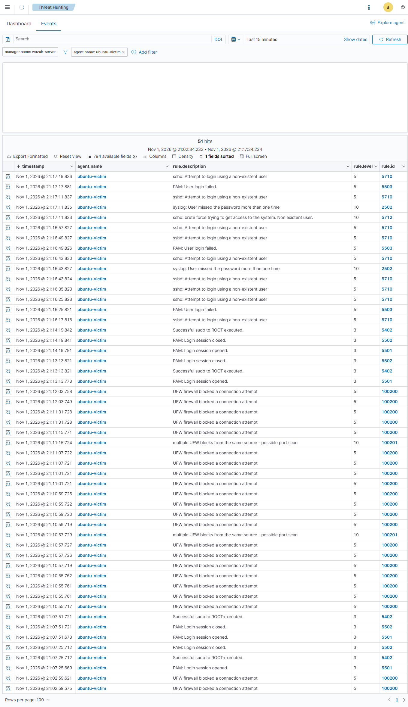
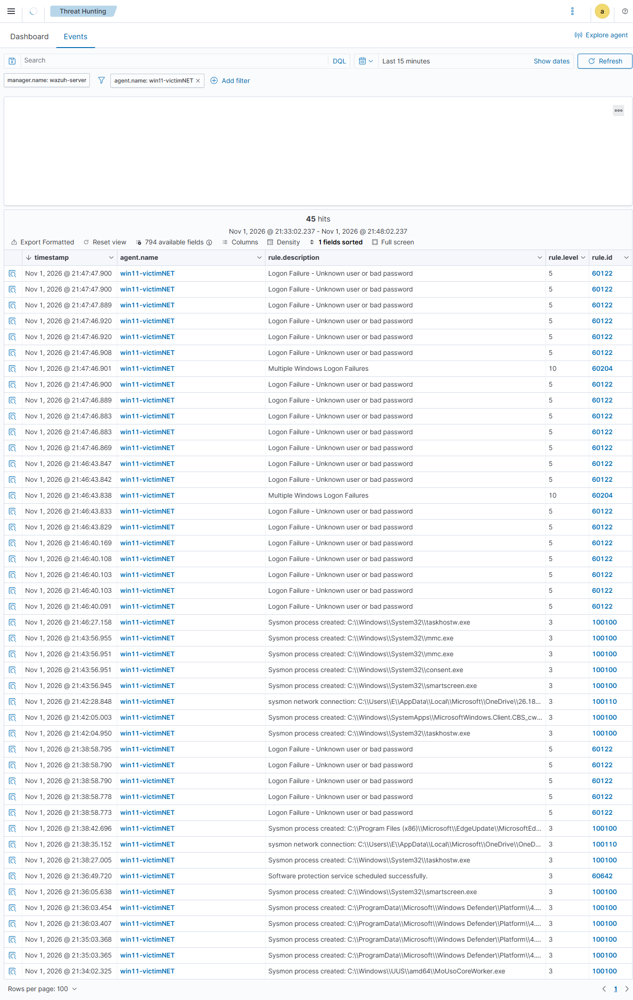
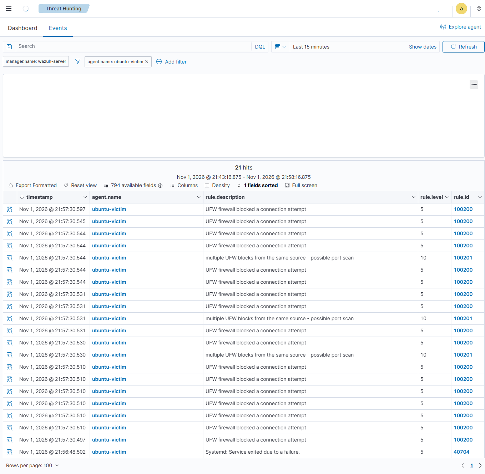
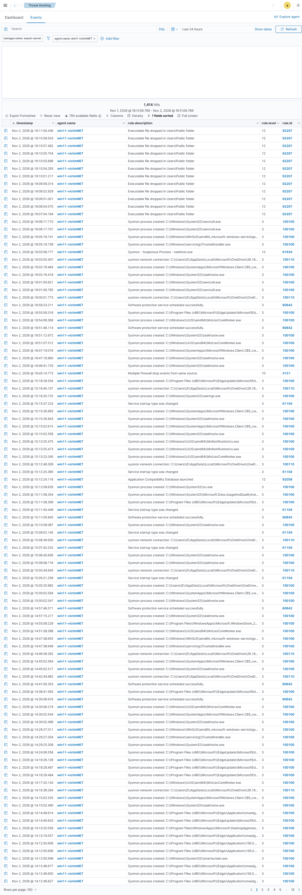
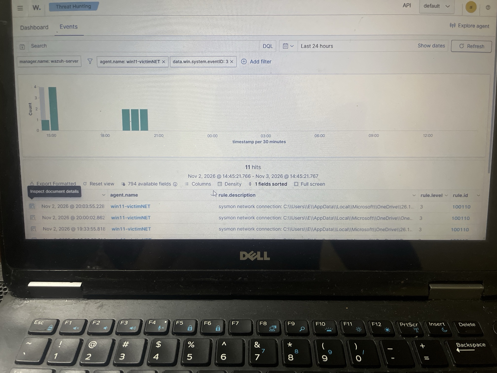

# Attack-and-Detect Home Lab with Wazuh

A virtual lab where I attack two victim machines from Kali Linux and detect those attacks in a Wazuh SIEM. I wrote custom decoders and rules for detections that Wazuh does not provide out of the box.

**Skills shown:** SIEM deployment, agent configuration, log analysis, custom decoder and rule writing, Sysmon tuning, MITRE ATT&CK mapping, troubleshooting.

---
## Setup Summary

1. Imported the Wazuh OVA into VirtualBox and confirmed the dashboard at `https://192.168.0.xxx`.
2. Built the Ubuntu VM, installed the Wazuh agent, enabled `ufw` with logging.
3. Built the Windows 11 VM ( GB disk, EFI, manual install), installed the Wazuh agent and Sysmon.
4. Built Kali and confirmed it could reach both victims.
5. Confirmed both agents showed **Active** in the dashboard before testing.
- **Hypervisor:** VirtualBox, all VMs on bridged networking so they share one LAN.
---


## Lab architecture

| VM | Hostname / Agent name | IP | Role | OS |
| --- | --- | --- | --- | --- |
| Attacker | `kaliz` | 192.168.0.xxx | Generates attack traffic | Kali Linux |
| Victim (Linux) | `ub11` / `ubuntu-victim` | 192.168.0.xxx | Monitored endpoint | Ubuntu 26.10 |
| Victim (Windows) | `wn11` / `win11-victimNET` | 192.168.0.xxx | Monitored endpoint | Windows 11 Enterprise (evaluation) |
| SIEM | `wazuh-server` | 192.168.0.xxx | Collects, decodes, alerts | Wazuh v4.14.9 OVA |

All VMs run on a VirtualBox **Bridged Adapter** on the same `192.168.0.0/24` network.

## Custom Detection Content

Wazuh has no default rule for UFW firewall blocks, and its default rule for Sysmon network connections (Event ID 3) does not store an alert. Those events were received but never shown, so I wrote the following.

### Agent config (Ubuntu): `/var/ossec/etc/ossec.conf`

```xml
<localfile>
  <log_format>syslog</log_format>
  <location>/var/log/ufw.log</location>
</localfile>
```

### Decoder (Wazuh server): `/var/ossec/etc/decoders/local_decoder.xml`

```xml
<decoder name="ufw-block">
  <parent>kernel</parent>
  <prematch type="pcre2">\[UFW BLOCK\]</prematch>
  <regex type="pcre2">SRC=(\S+) DST=(\S+).*PROTO=(\S+) SPT=(\d+) DPT=(\d+)</regex>
  <order>srcip, dstip, protocol, srcport, dstport</order>
</decoder>
```

### Rules (Wazuh server): `/var/ossec/etc/rules/local_rules.xml`

```xml
<group name="sysmon,">
  <rule id="100100" level="3">
    <if_sid>61603</if_sid>
    <description>Sysmon process created: $(win.eventdata.image)</description>
  </rule>

  <rule id="100110" level="3">
    <if_group>sysmon_event3</if_group>
    <description>Sysmon network connection: $(win.eventdata.image) to $(win.eventdata.destinationIp):$(win.eventdata.destinationPort)</description>
  </rule>
</group>

<group name="firewall,ufw,">
  <rule id="100200" level="5">
    <decoded_as>kernel</decoded_as>
    <match>UFW BLOCK</match>
    <description>UFW firewall blocked a connection attempt</description>
    <group>firewall_drop,</group>
  </rule>

  <rule id="100201" level="10" frequency="8" timeframe="60">
    <if_matched_sid>100200</if_matched_sid>
    <same_source_ip />
    <description>Multiple UFW blocks from the same source - possible port scan</description>
    <group>recon,</group>
  </rule>
</group>
```

Rule 100201 correlates 8 or more blocked connections from the same source within 60 seconds into one higher-severity alert.

I checked the decoder and rules with `wazuh-logtest` before restarting the manager. A passing run showed rule `100200` at level 5 with "Alert to be generated".

---
## Results at a glance

| # | Test | Target | Wazuh rule(s) | Level | MITRE ATT&CK | Detected |
|---|------|--------|---------------|-------|--------------|----------|
| 1 | SSH brute force | Ubuntu | 5710, 5503, 2502, 5712 | 5 to 10 | T1110 | Yes |
| 2 | RDP brute force | Windows 11 | 60122 | 5 | T1110, T1021.001 | Yes |
| 3 | Nmap SYN scan | Ubuntu | 100200, 100201 (custom) | 5 to 10 | T1046 | Yes (Ubuntu only) |
| 4 | Executable dropped in `Users\Public` | Windows 11 | 92207 | 12 | 92207 | Yes |
| 5 | Sysmon network connection (Event ID 3) | Windows 11 | 100110 (custom) | 3 | n/a (detection capability test) | Partial |
---
## Test 1: SSH brute force (Ubuntu)

**Action** (from Kali): repeated failed logins with a non-existent user.

```bash
for i in {1..6}; do sshpass -p 'wrongpass' ssh -o StrictHostKeyChecking=no baduser@<ubuntu-ip>; done
```

**Detection:** each attempt raised rules **5710** (non-existent user) and **5503** (PAM login failed), both level 5. Repeated failures escalated to **2502** (user missed the password more than one time) and **5712** (SSH brute force), both level 10.

**MITRE ATT&CK:** T1110, Brute Force.



## Test 2: RDP brute force (Windows 11)

**Action** (from Kali):

```bash
for i in {1..5}; do xfreerdp3 /v:<windows-ip> /u:baduser /p:wrongpass /cert:ignore /auth-only; done
```

**Detection:** five alerts for rule **60122** (Logon Failure - Unknown user or bad password, level 5), generated from Windows Security Event ID 4625.

**MITRE ATT&CK:** T1110, Brute Force; T1021.001, Remote Desktop Protocol.



## Test 3: Nmap SYN scan

**Action** (from Kali):

```bash
sudo nmap -Pn -sS -p- <target-ip>
```

**Detection (Ubuntu):** UFW logged the blocked probes. Custom rule **100200** (level 5) fired for each one, and **100201** (level 10, possible port scan) fired when many blocks came from one source. UFW's `low` logging level rate-limits entries, so Wazuh saw a sample of the probes, not every one.

**Detection (Windows):** none. See [Limitations](#limitations-and-lessons-learned).

**MITRE ATT&CK:** T1046, Network Service Discovery.



## Test 4: Executable dropped in a public folder (Windows 11)

**Action** (on the Windows VM):

```powershell
New-Item -Path "C:\Users\Public\test_malware.exe" -ItemType File
```

**Detection:** Sysmon file-creation events were forwarded by the agent and matched rule **92207** (Executable file dropped in Users\Public folder, level 12). Repeated runs produced repeated alerts.

**MITRE ATT&CK:** use the technique shown in the `rule.mitre.id` field of the alert.



## Test 5: Sysmon network connection (Windows 11)

**Action** (on the Windows VM, repeated 8 times):

```powershell
Invoke-WebRequest http://example.com -UseBasicParsing | Out-Null
curl.exe -I https://example.com
```

**Detection:** Sysmon Event ID 3 reaches Wazuh and custom rule **100110** matches it. The alerts captured in the dashboard are from **OneDrive background connections**, not from the commands above. Event Viewer on the Windows VM showed Sysmon Event ID 3 entries for PowerShell, but no matching Wazuh alerts for the PowerShell or curl connections were found.

**MITRE ATT&CK:** not mapped. This test shows the detection pipeline works. It does not simulate an attack technique.



## Limitations and lessons learned

- **No Windows detection for the Nmap scan.** Windows Firewall logging was enabled (`pfirewall.log`) and the log was added to the agent as a `<localfile>`. The scan produced no `DROP TCP` entries, only unrelated UDP multicast noise (SSDP) from another device on the network. Without TCP drops in the log, there was nothing for a rule to match. A rule matching any `DROP` line would have caused false positives from that SSDP traffic, so I matched `DROP TCP` only.
- **PowerShell and curl connections were not alerted.** Sysmon logged them locally, but they did not appear in Wazuh. The cause was not established. Next steps: check for a `<query>` filter on the agent's Sysmon `localfile` block, and review the Sysmon config's `NetworkConnect` rules.
- **Misplaced `<localfile>` block stopped the agent.** The agent failed with error 1230 (invalid element) because a `<localfile>` had been placed inside `<client>`. It must sit directly under `<ossec_config>`. `xmllint --noout ossec.conf` finds this quickly.
- **A typo in `local_rules.xml` took the manager down.** A missing `>` on a rule tag made `wazuh-analysisd` fail on startup. Run `sudo /var/ossec/bin/wazuh-analysisd -t` before every manager restart.
- **Agent name case created a duplicate agent.** Re-enrolling as `win11-victimNET` after `win11-victimNet` created a second agent ID. Wazuh treats names as case-sensitive.
- **Kali needs `-Pn` against Windows.** Windows blocks ping by default, so Nmap can decide the host is down and skip the scan.
- **VM clock drift.** The VMs and the Wazuh server had different time settings, so timestamps differ across screenshots. Check `date` on every VM and the timezone before capturing evidence.


## Tools

VirtualBox, Kali Linux, Nmap, `sshpass`, FreeRDP (`xfreerdp3`), Sysmon, Wazuh 4.14.9, UFW.
---
*Built as a hands-on project after completing TryHackMe SOC Level 1.*
